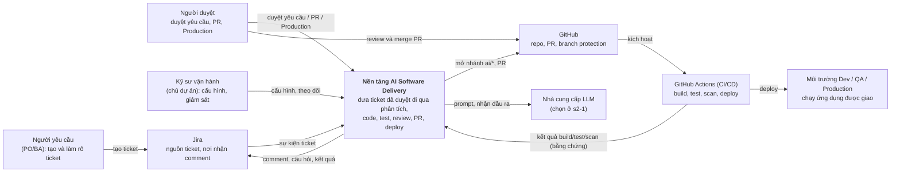
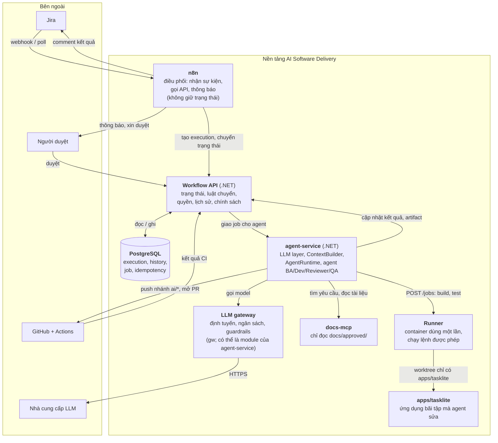

# C4: kiến trúc mục tiêu của nền tảng AI Software Delivery

> Đây là kiến trúc **mục tiêu** (tên và ranh giới theo `documents/knowledge/platform-reference.md`), chưa phải thứ đã dựng. Khi dựng thật mà khác thì sửa sơ đồ và ghi ADR.
> Vẽ bằng Mermaid `flowchart` (hiển thị ổn định trên GitHub). Mũi tên có nhãn là "ai gọi ai, để làm gì".

## Tầng 1: Context

Hệ thống nằm ở đâu và ai tương tác với nó.

Quan sát: có **3 cổng người** (duyệt yêu cầu, duyệt PR, duyệt Production). Bằng chứng build/test đến từ **CI**, không từ lời của agent.

## Tầng 2: Container

Bên trong nền tảng có những thứ chạy được nào. "Container" ở đây là một tiến trình hoặc dịch vụ riêng, không nhất thiết là Docker.

### Ranh giới cần nhớ (xem `platform-reference.md` §3)

| Container | Nắm giữ | Không được nắm |
|---|---|---|
| n8n | Trigger, định tuyến, thông báo, tích hợp | Trạng thái; thực thi tùy ý trên host |
| Workflow API | Trạng thái, luật chuyển trạng thái, quyền, bản ghi thực thi | Suy luận LLM |
| agent-service | Suy luận của agent trong ranh giới được cấp | Quyết định bỏ qua cổng; merge hay deploy |
| Runner | Chạy lệnh được phép trong môi trường hạn chế | Bí mật rộng, hạ tầng Production |
| CI/CD | Build, test, scan, deploy lặp lại được | Tin kết quả agent tự báo |

### Ghi chú thiết kế

- **Một nguồn sự thật cho trạng thái:** chỉ Workflow API ghi trạng thái; n8n và agent chỉ gọi API.
- **Cô lập vùng TaskLite (D4):** runner mount chỉ `apps/tasklite/`; agent không thấy `practice/backlog/` (đáp án chấm).
- **Hàng đợi:** giai đoạn đầu nằm trong PostgreSQL (`Job` có lease). Có tách broker hay không chốt ở `s8-1` bằng ADR.
- **Chưa có:** LangGraph, Temporal, vector DB riêng (pgvector trong PostgreSQL khi tới `ctx`), Kubernetes. Xem [ADR 0001](../decisions/0001-n8n-dotnet-truoc-langgraph-temporal-khi-co-ly-do.md).
