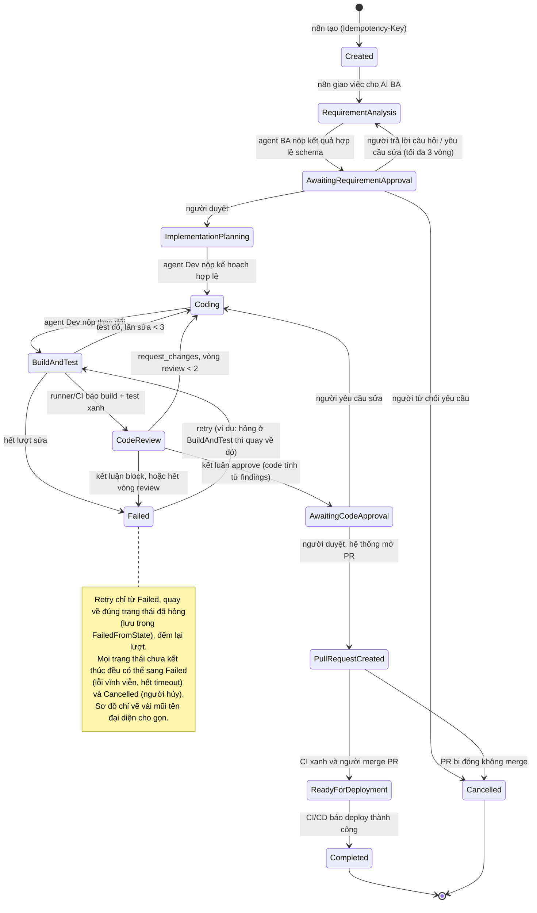

# State machine của một lần chạy (WorkflowExecution)

> Việc `s1-1`. Đây là thiết kế; cài đặt ở `s1-2` (bảng chuyển), `s1-3` (optimistic concurrency, API), `s1-4` (idempotency), kiểm chứng ở `s1-5`.
> Nguồn sự thật duy nhất về trạng thái là **Workflow API** (PostgreSQL). Nhãn Jira chỉ để người nhìn, không dùng để quyết định gì.

## 1. Sơ đồ

Trạng thái cuối: `Completed`, `Cancelled`. `Failed` không phải cuối hẳn: lối ra duy nhất là retry, và chỉ người (hoặc n8n theo chính sách có giới hạn cho lỗi tạm thời) được kích hoạt.

## 2. Bảng chuyển trạng thái hợp lệ

Mọi chuyển trạng thái đi qua **một hàm duy nhất** trong Workflow API. Hàm đó kiểm tra 3 thứ: (1) cặp `từ → sang` có trong bảng, (2) **loại actor** gửi request có đúng cột "Ai kích hoạt", (3) `expectedVersion` khớp version hiện tại. Sai bất kỳ điều nào thì từ chối và không ghi gì.

| # | Từ | Sang | Ai kích hoạt | Điều kiện |
|---|---|---|---|---|
| 1 | (chưa có) | Created | n8n | Sự kiện Jira "ticket sẵn sàng"; `Idempotency-Key` chưa tồn tại |
| 2 | Created | RequirementAnalysis | n8n | Đã giao job cho AI BA |
| 3 | RequirementAnalysis | AwaitingRequirementApproval | agent (BA) | Đầu ra `RequirementAnalysis` qua kiểm tra schema |
| 4 | AwaitingRequirementApproval | ImplementationPlanning | **người** | Người duyệt yêu cầu |
| 5 | AwaitingRequirementApproval | RequirementAnalysis | **người** | Trả lời câu hỏi / yêu cầu sửa; số vòng < 3 |
| 6 | AwaitingRequirementApproval | Cancelled | **người** | Từ chối yêu cầu |
| 7 | ImplementationPlanning | Coding | agent (Dev) | `ImplementationPlan` qua kiểm tra schema |
| 8 | Coding | BuildAndTest | agent (Dev) | Đã có commit trong worktree |
| 9 | BuildAndTest | CodeReview | runner/CI | Exit code build và test = 0 |
| 10 | BuildAndTest | Coding | runner/CI | Test đỏ; số lần sửa < 3 |
| 11 | BuildAndTest | Failed | runner/CI | Test đỏ; đã sửa đủ 3 lần |
| 12 | CodeReview | AwaitingCodeApproval | agent (Reviewer) | Kết luận `approve`, **do code tính** từ mức độ findings |
| 13 | CodeReview | Coding | agent (Reviewer) | Kết luận `request_changes`; số vòng review < 2 |
| 14 | CodeReview | Failed | agent (Reviewer) | Kết luận `block`, hoặc hết vòng review |
| 15 | AwaitingCodeApproval | PullRequestCreated | **người** | Người duyệt; hệ thống mở PR (idempotent theo tên nhánh) |
| 16 | AwaitingCodeApproval | Coding | **người** | Người yêu cầu sửa |
| 17 | PullRequestCreated | ReadyForDeployment | CI + **người** | CI xanh trên PR và người merge (sự kiện GitHub qua n8n) |
| 18 | PullRequestCreated | Cancelled | **người** | PR bị đóng không merge |
| 19 | ReadyForDeployment | Completed | CI/CD | Deploy thành công (P2 thêm cổng duyệt Production) |
| 20 | Bất kỳ trạng thái chưa kết thúc | Failed | hệ thống | Lỗi vĩnh viễn, hết timeout, hết lượt retry tự động |
| 21 | Bất kỳ trạng thái chưa kết thúc | Cancelled | **người** | Người hủy lần chạy |
| 22 | Failed | Trạng thái đã hỏng (`FailedFromState`) | **người** (hoặc n8n theo chính sách) | Qua `POST /executions/{id}/retry`; đếm lại lượt |

Không có trong bảng nghĩa là **bị từ chối**. Ví dụ bị từ chối:
- `RequirementAnalysis → Coding` (agent BA muốn bỏ qua bước duyệt): không có dòng nào cho phép.
- `AwaitingRequirementApproval → ImplementationPlanning` do **agent** gửi: đúng cặp trạng thái nhưng sai actor (dòng 4 chỉ cho người).
- `Completed → bất kỳ`: trạng thái cuối.

Mỗi lần chuyển thành công ghi một dòng `WorkflowHistory` (FromState, ToState, ChangedAt, ChangedBy, Reason) và tăng `Version`.

### Vì sao agent chỉ được "nộp bài", không được "duyệt"

Agent chỉ kích hoạt chuyển từ **bước nó đang làm** sang **bước kế tiếp**, và chỉ khi đầu ra qua kiểm tra schema. Ba cổng duyệt (dòng 4, 15, 17) chỉ người kích hoạt được. Số vòng lặp tối đa (3, 2) do code giữ, không do LLM quyết. Đây là nguyên tắc "code tất định giữ trạng thái, quyền, cổng chất lượng".

## 3. Ba kịch bản sự kiện trùng và cách chặn

### Kịch bản 1: Webhook Jira đến hai lần (hoặc hai lần poll chồng nhau)

- **Chuyện gì xảy ra:** Jira gửi lại webhook vì phản hồi chậm (at-least-once), hoặc hai lần poll cùng thấy TAS-5 sẵn sàng. Hai request `POST /executions` gần như cùng lúc.
- **Nếu không chặn:** cả hai cùng kiểm tra "chưa có execution", cùng tạo, hai agent cùng làm một ticket, ra hai PR.
- **Cách chặn:** request mang `Idempotency-Key` (ví dụ `jira:TAS-5:<id sự kiện>`). Bảng idempotency có **unique index** trên key. Request thứ hai bị DB từ chối vì trùng khóa, API bắt lỗi đó và **trả lại execution đã tạo** (cùng status code, cùng body). Không dùng "kiểm tra rồi chèn" và không dùng lock trong app.

### Kịch bản 2: n8n retry cùng một lệnh chuyển trạng thái

- **Chuyện gì xảy ra:** n8n gọi `POST /executions/42/transitions` (`Created → RequirementAnalysis`), bị timeout. Thật ra API đã chuyển thành công, chỉ mất phản hồi. n8n retry.
- **Nếu không chặn:** chuyển lần hai từ trạng thái mới (sai), hoặc giao việc cho AI BA hai lần.
- **Cách chặn:** request mang `expectedVersion`. Lần đầu: version 1 → 2, thành công. Lần retry vẫn gửi `expectedVersion = 1`, nên API trả **409 Conflict**, không ghi gì. n8n đọc lại `GET /executions/42`, thấy đã ở `RequirementAnalysis` (đúng trạng thái đích), coi như thành công. Tác dụng phụ (giao job) gắn idempotency key theo `executionId + toState` để không giao hai lần.

### Kịch bản 3: Hai người cùng bấm duyệt (hoặc một người bấm hai lần)

- **Chuyện gì xảy ra:** Execution 42 đang ở `AwaitingCodeApproval`, version 7. Hai người duyệt, hoặc một người double-click, gửi hai lệnh duyệt gần như đồng thời.
- **Nếu không chặn:** hai lần chuyển, có thể mở hai PR.
- **Cách chặn:** optimistic concurrency. Câu UPDATE có điều kiện `WHERE Id = 42 AND Version = 7`. Chỉ một request cập nhật được (version thành 8); request kia cập nhật 0 dòng, nên trả **409**, giao diện tải lại và hiện "đã được duyệt bởi ...". Riêng việc mở PR còn kiểm tra "nhánh `ai/TAS-5-...` đã có PR chưa" trước khi tạo, để an toàn cả khi timeout.

## 4. Vì sao nhãn Jira không đủ làm nguồn trạng thái

Phase 1 dùng nhãn `ai-picked`, marker trong comment PR và một Set trong bộ nhớ runner.

| Kịch bản hỏng | Nhãn Jira / bộ nhớ | Workflow API |
|---|---|---|
| Runner restart | Set trong bộ nhớ mất, việc cũ bị làm lại | Trạng thái nằm trong PostgreSQL, không mất |
| Hai lần poll chồng nhau | Cả hai thấy chưa có nhãn, cùng nhận việc | Idempotency key + unique index (kịch bản 1) |
| Ai đó xóa nhãn hay comment | Hệ thống "quên" việc đã làm | Trạng thái chỉ đổi qua API, có kiểm tra quyền |
| Mất phản hồi khi tạo PR | Không biết PR đã có chưa | Kiểm tra PR theo nhánh trước khi tạo; trạng thái và lịch sử cho biết đã tới bước nào |
| Muốn biết "vì sao đang ở đây" | Không có lịch sử | `WorkflowHistory` ghi ai chuyển, lúc nào, lý do |
| Chuyển sai thứ tự | Nhãn nào cũng gắn được | Bảng chuyển hợp lệ từ chối |

Nhãn Jira là ghi chú ai cũng sửa được: không giao dịch, không khóa, không lịch sử, không kiểm tra thứ tự. Nó vẫn có ích để người nhìn trên board, nhưng chỉ được **cập nhật theo** Workflow API, không bao giờ được **đọc để quyết định**.

## 5. Các con số cần chốt ở `s1-2`

Số vòng sửa yêu cầu (3), lần sửa sau test đỏ (3), vòng review (2) là giá trị khởi đầu, đặt trong cấu hình và ghi lại khi đổi. Timeout từng trạng thái chờ người (bao lâu thì nhắc, bao lâu thì `Failed`) chưa chốt; quyết ở `s1-5` hoặc `s12`.
