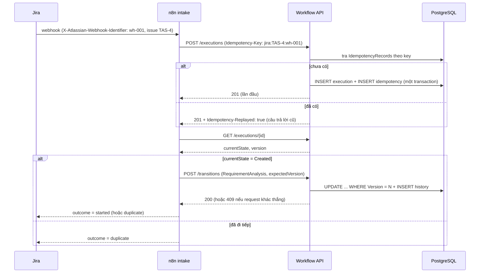

# Ghi chú học: Mốc 3 · Workflow API (s1-1 → s1-5)

> Tài liệu học cho chính mình: đã xây gì, vì sao, code nằm đâu, chạy thử thế nào. Cập nhật 2026-11-22.
> Thiết kế chính thức: `docs/architecture/workflow-states.md`. Cách dùng API: `apps/workflow-api/README.md`. Workflow n8n: `workflows/n8n/README.md`.

## 1. Bức tranh lớn: vì sao cần Workflow API

Phase 1 biết "việc nào đã làm" bằng nhãn Jira `ai-picked`, marker trong comment PR và một Set trong bộ nhớ runner. Cách này hỏng khi:

| Chuyện xảy ra | Hậu quả ở phase 1 |
|---|---|
| Runner khởi động lại | Set trong bộ nhớ mất, việc cũ bị làm lại |
| Hai lần poll chồng nhau | Cả hai thấy chưa có nhãn, cùng nhận việc, ra hai PR |
| Ai đó xóa nhãn | Hệ thống quên việc đã làm |
| Mất phản hồi khi tạo PR | Không biết PR có chưa |

Phase 2 đưa trạng thái vào **một chỗ duy nhất có database**: Workflow API. Mọi bên khác (n8n, agent, người, CI) chỉ **gọi API**, không tự giữ trạng thái.

```
Jira ──webhook──► n8n (5679) ──HTTP──► Workflow API (5300) ──► PostgreSQL (5433)
                  lễ tân: chuyển lời     văn phòng: luật + sổ sách
```

## 2. s1-1 · Thiết kế: state machine 13 trạng thái

Một lần chạy (`WorkflowExecution`) đi qua các bước:

```
Created → RequirementAnalysis → AwaitingRequirementApproval → ImplementationPlanning → Coding
→ BuildAndTest → CodeReview → AwaitingCodeApproval → PullRequestCreated → ReadyForDeployment → Completed
(bất kỳ bước nào) → Failed (retry được) | Cancelled (kết thúc)
```

Ba ý quan trọng nhất:
1. **Ai được đẩy bước nào** là luật cứng. Agent chỉ được "nộp bài" (từ bước nó đang làm sang bước kế). Ba cổng duyệt (yêu cầu, code, merge) chỉ **người** mới mở.
2. **Vòng lặp có giới hạn, code đếm:** test đỏ quay lại `Coding` tối đa 3 lần; reviewer yêu cầu sửa tối đa 2 vòng; người hỏi lại yêu cầu tối đa 3 vòng.
3. **`Failed` nhớ chỗ hỏng** (`FailedFromState`), retry quay về đúng chỗ đó, không chạy lại từ đầu.

## 3. s1-2 · State machine trong code

Thư mục: `apps/workflow-api/src/WorkflowApi.Domain/` (logic thuần, không DB).

| File | Vai trò |
|---|---|
| `WorkflowState.cs` | 13 trạng thái |
| `Actor.cs` | Ai gửi lệnh: `N8n`, `Agent`, `Human`, `Ci`, `System` |
| `TransitionTable.cs` | **Bảng luật**, viết dạng dữ liệu: từ đâu → sang đâu, ai được làm, điều kiện |
| `WorkflowStateMachine.cs` | Hàm `Apply`: **chỗ duy nhất** đổi trạng thái |
| `WorkflowExecution.cs` | Thực thể. Setter đều `internal`, nên ngoài `Apply` không ai ghi được |

Một dòng luật:
```csharp
Add(AwaitingRequirementApproval, ImplementationPlanning, [ActorType.Human]);  // chỉ người được duyệt yêu cầu
```

`Apply` hỏi 5 câu theo thứ tự, sai câu nào thì từ chối và **không ghi gì**:

| # | Câu hỏi | Sai thì |
|---|---|---|
| 1 | `expectedVersion` có khớp version hiện tại? | `VersionConflict` |
| 2 | Đã ở trạng thái cuối chưa? | `TerminalState` |
| 3 | Cặp "từ → sang" có trong bảng? | `NotAllowed` |
| 4 | Loại người gửi có được phép? | `ActorNotAllowed` |
| 5 | Điều kiện phụ (còn lượt sửa?) có thỏa? | `GuardFailed` |

Qua hết thì: đếm vòng (nếu có), đổi trạng thái, `Version + 1`, ghi một dòng lịch sử (ai, lúc nào, từ đâu sang đâu, lý do).

## 4. s1-3 · Lưu PostgreSQL và chống ghi đè

Thư mục: `apps/workflow-api/src/WorkflowApi.Api/` (ASP.NET minimal API + EF Core).

### Endpoint
| Method | Route | Ý nghĩa |
|---|---|---|
| POST | `/executions` | Tạo lần chạy (từ s1-4: bắt buộc `Idempotency-Key`) |
| GET | `/executions/{id}` | Trạng thái hiện tại, `version` |
| GET | `/executions/{id}/history` | Lịch sử theo thời gian |
| POST | `/executions/{id}/transitions` | Chuyển trạng thái: `toState`, `actor`, `expectedVersion`, `reason` |

### Optimistic concurrency: "chỉ ghi nếu chưa ai đổi"
Một dòng cấu hình trong `Data/WorkflowDbContext.cs`:
```csharp
b.Property(e => e.Version).IsConcurrencyToken();
```
EF Core khi lưu sẽ sinh:
```sql
UPDATE "WorkflowExecutions" SET "CurrentState" = 'RequirementAnalysis', "Version" = 2
WHERE "Id" = @id AND "Version" = 1;   -- 1 = version lúc mình đọc
```
Hai request cùng đọc version 1: request nhanh hơn ghi được; request chậm hơn khớp 0 dòng, EF ném `DbUpdateConcurrencyException`, API trả **409**. Dòng lịch sử của request thua rollback theo (cùng transaction).

Hai lớp chặn:
| Lớp | Ở đâu | Bắt |
|---|---|---|
| Kiểm tra trong code | `Apply` so `expectedVersion` | Request đến muộn (đã có người đổi xong) |
| Concurrency token | Câu `UPDATE ... WHERE Version = N` | Hai request đọc **cùng lúc** |

### Mã HTTP
| HTTP | Khi nào | Client nên làm |
|---|---|---|
| 409 | Lệch version | Đọc lại trạng thái rồi quyết định |
| 403 | Sai loại người gửi | Dừng |
| 422 | Chuyển không hợp lệ, trạng thái cuối, hết lượt | Dừng |
| 400 | Đầu vào sai (tên trạng thái `"1"`, thiếu `expectedVersion`) | Sửa request |

## 5. s1-4 · Tiếp nhận idempotent và n8n

### Nửa A: `POST /executions` với `Idempotency-Key`
Hình dung **quầy gửi đồ có số vé**: cùng số vé thì trả lại đúng món đồ cũ, không nhận thêm.

- Vé: header `Idempotency-Key`, dạng `jira:<issue>:<id sự kiện>`.
- Sổ: bảng `IdempotencyRecords` (key, dấu vân tay nội dung, id lần chạy, câu trả lời đã gửi).

Luồng trong `ExecutionEndpoints.CreateExecution`:
```
Kiểm tra đầu vào (thiếu vé → 400)
Tra sổ theo vé
  ├─ có, cùng nội dung → trả lại NGUYÊN VĂN câu trả lời cũ (201 + Idempotency-Replayed: true)
  ├─ có, khác nội dung → 422 IdempotencyKeyReused
  └─ chưa có → tạo lần chạy + dòng sổ, lưu CHUNG một transaction
                 ├─ lưu được → 201
                 └─ DB báo trùng vé (request khác vừa thắng) → đọc dòng sổ của nó, trả lại
```

Điểm mấu chốt: **tra sổ không đủ** khi hai request đến cùng lúc (cả hai thấy sổ trống). Cột vé là **khóa chính** nên DB chỉ cho một dòng; đây là chốt chặn cuối. Đã chứng minh bằng cách phá code:

| Bỏ phần | Kết quả |
|---|---|
| Tra sổ trước | Vẫn đúng 39/39 (chỉ tốn thêm một lần ghi rồi hủy) |
| Khối `catch` trùng vé | Không tạo trùng, nhưng request thua nhận 500 |

### Nửa B: workflow n8n `intake` (`workflows/n8n/intake.json`)
```
Jira webhook → Create execution → Created by API? ─ok─→ Get current state → Route by state ─Created──→ Start requirement analysis → Respond started
                                                 └rejected─→ Respond rejected                └đã đi tiếp─→ Respond duplicate
```
- n8n **không giữ trạng thái**, không đọc nhãn Jira. Nó hỏi Workflow API "lần chạy đang ở đâu" rồi mới rẽ nhánh.
- Bước "Get current state" cần thiết vì khi gửi lại, `POST /executions` trả kết quả **gốc** (`Created`). Nếu lần trước tạo được nhưng n8n sập trước khi chuyển bước, hỏi trạng thái thật giúp tự phục hồi thay vì kẹt.
- 5 webhook cùng lúc: `Idempotency-Key` cho một lần chạy; cả 5 cùng gọi chuyển trạng thái với `expectedVersion = 1`, concurrency token cho 1 cái thắng, 4 cái 409 thành `duplicate`.

## 5b. s1-5 · Kiểm chứng bước 1: tìm lần chạy lỗi và retry an toàn

Loại `eval`: không thêm tính năng lớn, mà **chứng minh** 5 tiêu chí của bước 1 bằng test, rồi phá code để chắc test bắt được lỗi.

### Thêm 2 endpoint

| Endpoint | Làm gì |
|---|---|
| `GET /executions?state=Failed` | Tìm lần chạy đang hỏng (lọc thêm `jiraIssueKey`, `limit`). Có index `(CurrentState, UpdatedAt)` cho truy vấn này |
| `POST /executions/{id}/retry` | Body chỉ có `actor`, `expectedVersion`, `reason`. **Không có `toState`** |

### Retry nằm ở đâu trong code

`WorkflowStateMachine.Retry` (`src/WorkflowApi.Domain/WorkflowStateMachine.cs`):

```csharp
if (execution.Version != expectedVersion) return Reject(VersionConflict, ...);   // 409
if (execution.CurrentState != Failed || execution.FailedFromState is null)
    return Reject(NotAllowed, "Only a Failed execution can be retried");          // 422
var request = new TransitionRequest(execution.FailedFromState.Value, actor, expectedVersion, reason ?? "Retry");
return Apply(execution, request, now);   // vẫn qua 5 câu kiểm tra: actor phải là Human/N8n (403 nếu Agent)
```

Ba ý chính:
- **Server chọn đích, không phải người gọi.** Đích luôn là `FailedFromState`, nên không ai retry "nhảy" sang `PullRequestCreated` được.
- **Cùng một execution (cùng id).** Retry là một dòng chuyển trạng thái `Failed → Coding` trong lịch sử, không phải lần chạy mới. Lịch sử giữ cả dòng hỏng lẫn dòng retry, nên xem lại được chuyện gì đã xảy ra.
- **An toàn khi gửi trùng.** n8n timeout rồi gửi lại cùng `expectedVersion` thì nhận 409, chỉ một lần có hiệu lực. 8 retry cùng lúc: concurrency token ở DB cho 1 cái thắng.

Endpoint `Retry` dùng chung `SaveTransitionAsync` với `Transition` (lưu, bắt `DbUpdateConcurrencyException` thành 409).

### Lỗi tạm thời và lỗi vĩnh viễn

| Loại | Ví dụ | Ai xử lý |
|---|---|---|
| Tạm thời | Mạng chập, rate limit, nhà cung cấp LLM sập | Retry (người hoặc n8n; tự động có giới hạn ở `s8`) |
| Vĩnh viễn | Ticket mơ hồ, hết 3 lượt sửa, sai quyền | Người xem lại, sửa đầu vào, hoặc `Cancelled`. Retry chỉ lặp lại lỗi |

### 5 tiêu chí ↔ test (`Step1CriteriaTests.cs`)

| Tiêu chí | Test chứng minh |
|---|---|
| 1. Trạng thái được lưu | Đọc lại bằng **kết nối DB riêng**, không qua API |
| 2. Chuyển sai bị từ chối | Nhảy bước 422, sai người 403, sai version 409; trạng thái và lịch sử không đổi |
| 3. Sự kiện trùng không tạo lần chạy trùng | 5 request cùng lúc + 1 gửi lại cùng key: 1 lần chạy |
| 4. Xem được lịch sử | Đúng thứ tự, có người gửi |
| 5. Lần chạy lỗi tìm được, retry an toàn | Tìm qua `?state=Failed`; retry 2 lần: 200 rồi 409; số lần chạy trong DB không tăng |

### Phá code để kiểm tra test (mutation)

| Phá thế này | Kết quả |
|---|---|
| Retry "ngây thơ" = tạo lần chạy mới | 10 test fail |
| Bỏ concurrency token | Lần đầu test song song **vẫn pass** (1 vòng, các request chạy lần lượt nên không thật sự đua). Sửa test thành 10 vòng thì fail đúng: 8/8 thành công |

Bài học: một test song song pass chưa chắc đã chứng minh gì. Phải phá thử code để thấy test có fail không.

## 6. Một webhook đi qua hệ thống (sequence)



## 7. Chạy và thử

```bash
# Hạ tầng: PostgreSQL + Workflow API + n8n phase 2 (cần Docker; .env trong infra/docker đã có)
cd infra/docker && docker compose up -d --build

# Test (Testcontainers tự bật PostgreSQL riêng)
cd apps/workflow-api && dotnet test WorkflowApi.slnx

# Gửi webhook giả lập Jira
curl -s -X POST http://localhost:5679/webhook/jira-intake \
  -H "Content-Type: application/json" -H "X-Atlassian-Webhook-Identifier: wh-001" \
  -d '{"timestamp":1763700000000,"issue":{"key":"TAS-4"}}'
```

Giao diện n8n: `http://localhost:5679` (lần đầu tạo tài khoản owner), xem lịch sử từng lần chạy workflow.

## 8. Bằng chứng đã có

| Việc | Bằng chứng |
|---|---|
| s1-2 | 84 test Domain; cho agent duyệt cổng yêu cầu thì 2 test fail đúng |
| s1-3 | 8 request song song cùng version × 10 vòng: mỗi vòng đúng 1 thành công, 7 nhận 409; bỏ concurrency token thì 8/8 thành công (test fail đúng) |
| s1-4 A | 10 test idempotency, 39 test API pass; phá code như bảng ở mục 5 |
| s1-5 | 101 test Domain + 65 test API pass; 5 test `Step1CriteriaTests` cho 5 tiêu chí; 2 mutation đều bị bắt |
| s1-4 B | Webhook thật qua n8n: gửi trùng ra `duplicate`, giả lập timeout ra `started` với lần chạy cũ, 5 webhook cùng lúc ra 1 `started` + 4 `duplicate`; DB mỗi issue đúng 1 lần chạy |

## 9. Giới hạn đã biết

- **Chưa xác thực:** `actor` nằm trong body, ai cũng tự nhận là `Human` được. Phải thay bằng token dịch vụ (`s7-2`, `s12`). Không mở API ra ngoài máy.
- Bản ghi idempotency chưa hết hạn.
- Jira Cloud chưa gọi được `localhost`: đang dùng webhook giả lập; webhook thật để `s6`.
- `s1-2` và `s1-4` là việc `core` nhưng do Claude code theo yêu cầu; nên tự viết lại một phần nhỏ (ví dụ một dòng luật mới + test) để chắc tay.

## 10. Tự kiểm tra

1. Agent BA gửi lệnh `AwaitingRequirementApproval → ImplementationPlanning`. Bị chặn ở câu thứ mấy trong 5 câu của `Apply`, và trả HTTP gì?
2. Nếu chỉ kiểm tra version trong code (không có concurrency token), vì sao 8 request song song vẫn có thể có hơn một cái thành công?
3. Vì sao lưu lần chạy và dòng `IdempotencyRecords` chung một transaction?
4. Vì sao workflow n8n phải gọi `GET /executions/{id}` thay vì tin câu trả lời của `POST /executions`?
5. Cùng một `Idempotency-Key` nhưng `jiraIssueKey` khác: API trả gì, và vì sao không lặng lẽ trả lần chạy cũ?
6. Vì sao `POST /retry` không cho người gọi truyền `toState`?
7. Retry tạo lần chạy mới (id mới) thì mất gì? (Gợi ý: lịch sử, idempotency của Jira, PR đang mở.)
